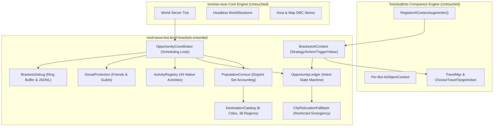

# Bot Level Brackets Extended for Turtle WoW


[](https://turtle-wow.org)
[-blue.svg)](https://github.com/tortoise-wow/tortoise-wow)
[](https://github.com/Sagiroth/TortoiseBots)
[]()
[]()
[]()
[]()

A next-generation, non-intrusive bot opportunity coordinator, capital city ambiance coordinator, and natural progression observer engineered specifically for **Turtle WoW custom vMaNGOS (`tortoise-wow`)** and the **`TortoiseBots`** companion AI engine.

---

## 🌟 What Does This Module Do?

The module coordinates bot world presence, capital city ambiance, and leveling progression through **Registered AI Opportunities**, eliminating forced level mutations and artificial teleports:

1. **AI Context Augmentation**: Registers custom AI strategies, actions, triggers, and values into `TortoiseBots` via `RegisterAiContextAugmenter()`. Bots receive opportunities and navigate autonomously using native `ChooseTravelTargetAction`, `TravelMgr`, and pathfinding.
2. **43 Native Bot Activities**: Incorporates all 43 native bot activities across Capital Cities (17) and Outdoor World (26) domains—including AH trading, banking, tavern rest, class training, racial visits, hunting, gathering, questing, and dungeon exploration.
3. **8 Capital City Hubs with Custom Turtle WoW Lore**: Balances resident quotas across Stormwind, Ironforge, Darnassus, **Alah'Thalas (High Elf)**, Orgrimmar, Undercity, Thunder Bluff, and **Sparkwater Port (Goblin)**.
4. **Natural Progression Observation (`ObserveNative`)**: Observes native bot leveling progression without direct `SetLevel`, `GiveLevel`, synthetic XP, or factory resets. Bracket targets are advisory and calculated via largest-remainder allocation.
5. **Restricted Emergency Fallback**: A safety net disabled by default (`Fallback.NativeRouteUnsupportedBeforeStart = 0`). Only activates for verified unreachable capital destinations with preflight checks, landing point validation, and 1-hour anti-churn throttles.
6. **Field Reserve Bound Guarantee**: Guarantees that at least 70% of bots remain in the open world, capping total city resident quotas to at most 30% of online bots.
7. **Comprehensive Social & Arena Protection**: Protects bots on real-player friend lists (`character_social`), in guilds with human members (online or offline), grouped with humans, commanded by masters, or participating in custom arenas (Blood Ring Map 26, Sunnyglade Map 27, Gurubashi).
8. **Module-Local Diagnostic Environment**: Fixed-capacity in-memory circular ring buffer (default 500 events), 20 categories, token-bucket rate limiter, JSONL telemetry export, and deep diagnostic inspection commands (`.blb explain bot`, `.blb explain city`, `.blb explain region`).

---

## 🏗️ Architecture Overview

Under **The Unediting Doctrine**, both `tortoise-wow` and `TortoiseBots` remain 100% untouched. All AI extensions and coordinators live strictly in standalone module space:



### AI Context Lifecycle
When a bot AI context initializes, the module registers fresh named contexts with `shared = false`:
* **`OpportunityStrategy` (`"blb opportunities"`)**: Non-combat strategy activating city and world opportunity triggers.
* **`CityOpportunityAction`**: Derived from `ChooseTravelTargetAction`; resolves landing coordinates from `DestinationCatalog` and sets native travel targets.
* **`WorldOpportunityAction`**: Derived from `ChooseTravelTargetAction`; resolves outdoor region envelopes with native purpose bitmasks (`Grind`, `Quest`, `Gather`).
* **`CityOpportunityTrigger` & `WorldOpportunityTrigger`**: Triggers firing when an opportunity is proposed, bot is alive, out of combat, and not engaged in higher-priority travel.
* **`OpportunityIntentValidValue`**: Boolean qualifier checking active intent validity in the ledger.

---

## 📊 Disjoint Population Census & Quota Math

### Single-Pass Disjoint Accounting
Online bots are surveyed in a single pass and strictly partitioned into disjoint sets:

$$\text{TotalOnlineBots} = \text{Residents} + \text{ConfirmedInbound} + \text{PendingProposed} + \text{Unmanaged}$$

* **Residents**: Bots currently within the bounding area of a capital city or outdoor region.
* **ConfirmedInbound**: Bots actively traveling to a destination (`PLANNING`, `TRAVELING`, `ARRIVED`).
* **PendingProposed**: Bots with a proposed intent awaiting AI trigger evaluation.
* **Unmanaged**: Bots excluded due to social protection, grouping, master control, or arena combat.

### Actionable Deficit & Hysteresis
To eliminate churning and oscillation, opportunities are scheduled only when an actionable deficit exists:

$$\text{Deficit} = \text{TargetQuota} - (\text{ActualResidents} + \text{ConfirmedInbound})$$

If $\text{Deficit} \le 0$, no new opportunities are generated for that destination.

### Field Reserve Bound
To guarantee that capital cities do not depopulate the leveling world:

$$\sum_{c \in \text{Cities}} \text{TargetQuota}(c) \le \text{TotalOnlineBots} \times (1.0 - \text{FieldReserveFraction})$$

*(Default: `FieldReserveFraction = 0.70`, strictly reserving at least 70% of bots for leveling zones).*

---

## 🎯 The 43 Native Bot Activities (Section 26 Catalog)

The module registers all 43 native activities with customizable selection weights, duration, cooldowns, and native purpose bitmasks:

| Domain | Count | Activities |
|:---|:---:|:---|
| **Capital Cities** | 17 | `AuctionBrowse`, `AuctionBid`, `BankDeposit`, `BankWithdraw`, `TavernRest`, `TavernDrink`, `ClassTrainer`, `ProfessionTrainer`, `WeaponTrainer`, `FirstAidTrainer`, `VendorSellJunk`, `VendorBuyFood`, `VendorRepair`, `CityPatrol`, `CityVisitGuild`, `CityVisitRacial`, `CityRestIdle`. |
| **Outdoor World** | 26 | `GrindMob`, `GrindBeast`, `GrindHumanoid`, `GrindUndead`, `GrindElemental`, `GrindDemon`, `GrindDragonkin`, `GatherHerb`, `GatherMine`, `GatherSkin`, `GatherFish`, `QuestTurnIn`, `QuestAccept`, `QuestComplete`, `ExploreRoad`, `ExploreRuins`, `ExploreCoast`, `ExploreMountain`, `ExploreCamp`, `DungeonRun`, `DungeonPrep`, `WorldPvPPatrol`, `WorldPvPDefend`, `RestCamp`, `ExploreTurtleZone`, `RacialValleyVisit`. |

*(See [**`docs/ACTIVITIES.md`**](docs/ACTIVITIES.md) for full details, bitmasks, and tuning).*

---

## 🛡️ Restricted Relocation Fallback

An emergency bridge for verified unreachable capital destinations:
* **Disabled by default**: `BotLevelBrackets.Fallback.NativeRouteUnsupportedBeforeStart = 0`.
* **Preflight Allowlist Only**: Triggers strictly when native pathfinding reports route unsupported before movement begins.
* **Capital Cities Only**: Outdoor world destinations strictly reject relocation.
* **Landing Verification**: Destination coordinates validated with ground raycast verification.
* **Hourly Throttle & Cooldown**: Capped at 5 relocations/hour server-wide; 1-hour anti-churn lock per bot; 2-hour backoff if the bot leaves prematurely (< 300s).

---

## 🛠️ In-Game Administration (`.blb` Commands)

The module registers administrative commands under the `.blb` and `.botbrackets` namespaces (Security Level 3 / Admin):

| Command | Arguments | Description |
|:---|:---|:---|
| `.blb status` | None | Displays overall module health, active debug mode, online bot census, city resident counts, and active opportunities. |
| `.blb ledger` | None | Displays Opportunity Ledger telemetry (active intents, state distribution, terminal stats). |
| `.blb opportunities` | None | Lists active bot intents with destination, activity, and elapsed duration. |
| `.blb activities` | None | Dumps all 43 registered native activities with domain flags and active weights. |
| `.blb explain bot` | `<bot_name>` | Deep diagnostic trace explaining why a bot was or was not selected for opportunities. |
| `.blb explain city` | `<city_name>` | Shows detailed census, target quota, inbound bots, and actionable deficit for a capital city. |
| `.blb explain region` | `<region_id>` | Shows detailed census, safe level envelope, and active activities for an outdoor leveling region. |
| `.blb debug mode` | `<Off\|Summary\|Trace\|DryRun>` | Changes diagnostic logging level live without restarting the server. |
| `.blb debug dump` | `[count]` | Dumps recent ring buffer events to chat or server log in JSONL format. |
| `.blb force cycle` | None | Manually triggers an immediate scheduling cycle. |
| `.blb reload` | None | Atomically reloads `mod_twow_bot_level_brackets.conf` without server reboot. |

---

## ⚙️ Configuration Reference

Edit `conf/mod_twow_bot_level_brackets.conf` (copied from `conf/mod_twow_bot_level_brackets.conf.dist`):

```ini
[BotLevelBrackets]
# Master enable switch (1 = enabled, 0 = disabled)
BotLevelBrackets.Enabled = 1

# Master distribution & opportunity scheduling cycle frequency in seconds (default: 300)
BotLevelBrackets.CheckFrequency = 300

# Maintenance tick interval in milliseconds (default: 5000)
BotLevelBrackets.MaintenanceTickMs = 5000

# Opportunity Time-To-Live in seconds before expiration (default: 180)
BotLevelBrackets.OpportunityTTLSeconds = 180

# Anti-churn cooldown in seconds before revisiting the same destination (default: 1800)
BotLevelBrackets.OpportunityCooldownSeconds = 1800

# Progression policy mode (ObserveNative = natural leveling, no forced level mutations)
BotLevelBrackets.LevelPolicy.Mode = ObserveNative

# Target quota allocation strategy (LargestRemainder = Hare-Niemeyer method)
BotLevelBrackets.LevelPolicy.TargetQuotaStrategy = LargestRemainder

# Capital city ambiance population enable switch
BotLevelBrackets.HubPopulation.Enabled = 1

# Minimum fraction of bots strictly reserved for the outdoor leveling world (default: 0.70)
BotLevelBrackets.HubPopulation.FieldReserveFraction = 0.70

# Capital city target resident quotas (Alliance)
BotLevelBrackets.HubPopulation.Alliance.Stormwind = 15
BotLevelBrackets.HubPopulation.Alliance.Ironforge = 12
BotLevelBrackets.HubPopulation.Alliance.Darnassus = 8
BotLevelBrackets.HubPopulation.Alliance.AlahThalas = 8

# Capital city target resident quotas (Horde)
BotLevelBrackets.HubPopulation.Horde.Orgrimmar = 15
BotLevelBrackets.HubPopulation.Horde.Undercity = 12
BotLevelBrackets.HubPopulation.Horde.ThunderBluff = 8
BotLevelBrackets.HubPopulation.Horde.Sparkwater = 8

# Outdoor regional world opportunities enable switch
BotLevelBrackets.WorldOpportunity.Enabled = 1

# Restricted emergency fallback (0 = disabled, 1 = enabled)
BotLevelBrackets.Fallback.NativeRouteUnsupportedBeforeStart = 0

# Diagnostic debug mode: Off, Summary, Trace, DryRun (default: Off)
BotLevelBrackets.Debug.Mode = Off

# Size of in-memory circular ring buffer for events (default: 500)
BotLevelBrackets.Debug.RingBufferSize = 500
```

---

## 📦 Installation & Setup

### 1. Repository Placement
Clone or place this repository into your server's `modules/` directory:
```bash
cd /path/to/tortoise-wow/modules/
git clone -b mod-twow-bot-level-brackets-extended https://github.com/Ildourol/mod-twow-bot-level-brackets.git mod-twow-bot-level-brackets-extended
```

### 2. Build Configuration
Run CMake to configure the build (CMake auto-detects `TortoiseBots` and includes native headers):
```bash
cd /path/to/tortoise-wow/build/
cmake .. -DMODULES=static
cmake --build . --config Release
```

### 3. Database Schema Import
Import the supporting SQL migrations into your character and world databases:
```bash
# Character database: Persistent guild tracker
mysql -u root -p tw_char < modules/mod-twow-bot-level-brackets-extended/data/sql/character/bot_level_brackets_guild_tracker.sql

# World database: Administrative command definitions
mysql -u root -p tw_world < modules/mod-twow-bot-level-brackets-extended/data/sql/world/bot_level_brackets_command.sql
```

### 4. Configuration Deployment
Copy the sample configuration file and customize as desired:
```bash
cp modules/mod-twow-bot-level-brackets-extended/conf/mod_twow_bot_level_brackets.conf.dist bin/mod_twow_bot_level_brackets.conf
```

---

## 📚 Supporting Documentation

* [**`docs/ARCHITECTURE.md`**](docs/ARCHITECTURE.md): Full technical architecture, AI context augmentation, disjoint population census, and state machine specifications.
* [**`docs/GUIDE.md`**](docs/GUIDE.md): Complete operator manual, configuration guide, and command reference.
* [**`docs/ACTIVITIES.md`**](docs/ACTIVITIES.md): Comprehensive catalog of all 43 native activities with bitmasks and defaults.
* [**`docs/DEBUG_ENVIRONMENT.md`**](docs/DEBUG_ENVIRONMENT.md): Diagnostic observability suite, categories, ring buffer, and JSONL format.
* [**`docs/MIGRATION_GUIDE.md`**](docs/MIGRATION_GUIDE.md): Step-by-step migration from legacy redistribution to registered opportunities.
