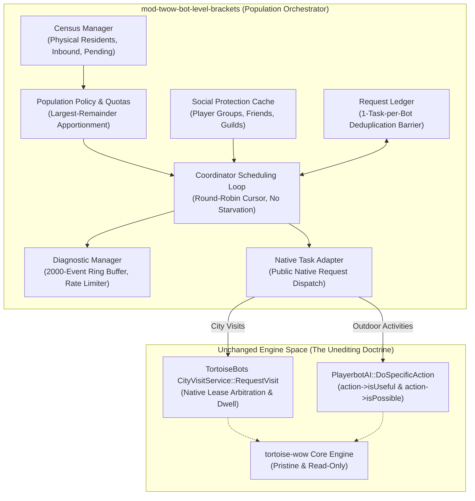

# Bot Level Brackets for Turtle WoW (Native-Task Population Orchestrator)


[](https://turtle-wow.org)
[-blue.svg)](https://github.com/tortoise-wow/tortoise-wow)
[](https://github.com/Sagiroth/TortoiseBots)
[]()
[]()
[](LICENSE)

An intelligent, non-intrusive population orchestrator engineered for **Turtle WoW custom vMaNGOS (`tortoise-wow`)** and the **`TortoiseBots`** companion AI engine.

The module monitors bot population distribution, identifies capital city and outdoor deficits, filters eligible bots, and requests **already implemented native tasks** through verified public entry points (`CityVisitService::RequestVisit` and `PlayerbotAI::DoSpecificAction`). The native bot engine owns 100% of gameplay execution, combat, pathfinding, and movement. Both the core server and bot engines remain completely untouched.

---

## 🌟 Key Features & Architectural Invariants



1. **Brackets Orchestrates; Unchanged Playerbots Executes:**
   The module never injects custom strategies, actions, triggers, or values (`RegisterAiContextAugmenter` is deliberately avoided). It queries existing native services to determine where bots are needed and requests genuine existing tasks.
2. **Strict Immutability (The Unediting Doctrine):**
   `tortoise-wow` (core) and `TortoiseBots` (bot engine) are 100% read-only. All scheduling, telemetry, state tracking, and commands reside exclusively within standalone module space.
3. **Zero Teleports & Zero Character Mutations:**
   No synthetic `Player::TeleportTo` calls, no factory re-provisioning, and no forced level mutations or artificial XP grants. Bots travel through the world organically using native engine pathfinding. Level supply shortages are tracked and reported as **Advisory**.
4. **Native Need & Feasibility Gates Preserved:**
   Every dispatched action flows through `PlayerbotAI::DoSpecificAction`, which evaluates `action->isUseful()` and `action->isPossible()` before execution. If a bot cannot perform an action, the native engine refuses it safely.
5. **Transient 1-Task-per-Bot Deduplication Barrier:**
   The `RequestLedger` ensures bots never receive duplicate or competing task requests while an existing request is pending or executing, backed by exponential backoff on native rejections.
6. **Round-Robin Anti-Starvation Scheduling:**
   A rotating cursor eliminates first-GUID bias, guaranteeing that candidate bots are evaluated fairly across the entire online population.
7. **8 Racial Capital City Hubs:**
   Full support for classic and custom Turtle WoW racial capitals:
   - **Alliance:** Stormwind, Ironforge, Darnassus, and Alah'Thalas (High Elf capital).
   - **Horde:** Orgrimmar, Undercity, Thunder Bluff, and Sparkwater Port (Goblin capital).
8. **42 Audited Native Activities:**
   Typed capability registry with individual configuration toggles for quest turn-ins, grinding, exploration, vendor visits, auction house, repairs, training, and gathering.
9. **Multi-Tier Social Safeguards:**
   Protects bots grouped with real players, on human friend lists, in human guilds (online or offline), or named in `ExcludedNames`.
10. **Comprehensive Administration & Telemetry:**
    Full in-game `.blb` command suite with a real-time diagnostic decision engine (`.blb explain <guid>`), 2000-event circular ring buffer, token-bucket rate limiter, and dry-run execution mode.

---

## 🏛️ Modular Subsystem Architecture

The codebase is organized into cleanly decoupled subsystems in `src/`:

| Subsystem | Source Location | Responsibility |
|:---|:---|:---|
| **`compat/`** | [`src/compat/NativeTaskAdapter.h`](src/compat/NativeTaskAdapter.h) | Thin abstraction layer dispatching requests to `CityVisitService` and `PlayerbotAI`. |
| **`policy/`** | [`src/policy/PopulationPolicy.h`](src/policy/PopulationPolicy.h)<br/>[`src/policy/QuotaAllocator.h`](src/policy/QuotaAllocator.h) | Configuration schema, target math, largest-remainder apportionment, and bounds clamping. |
| **`world/`** | [`src/world/ReadOnlyCatalog.h`](src/world/ReadOnlyCatalog.h)<br/>[`src/world/Census.h`](src/world/Census.h) | Hub catalog, outdoor zone definitions, and coherent point-in-time census snapshots. |
| **`scheduling/`** | [`src/scheduling/Coordinator.h`](src/scheduling/Coordinator.h)<br/>[`src/scheduling/RequestLedger.h`](src/scheduling/RequestLedger.h) | Periodic scheduling pass, cursor rotation, task deduplication, and rejection backoff. |
| **`activities/`** | [`src/activities/ActivityRegistry.h`](src/activities/ActivityRegistry.h) | Catalog of 42 audited native activities mapped to capability domains. |
| **`social/`** | [`src/social/ProtectionCache.h`](src/social/ProtectionCache.h) | Caches protecting bots interacting with real players or human guilds. |
| **`commands/`** | [`src/commands/BotBracketsCommands.h`](src/commands/BotBracketsCommands.h) | Implementation of all `.blb` GM and operator console commands. |
| **`debug/`** | [`src/debug/DiagnosticManager.h`](src/debug/DiagnosticManager.h) | Telemetry ring buffer, rate limiting, logging categories, and dry-run simulation. |

---

## 📋 Audited Native Activities Catalog

All 42 native bot activities are classified by capability domain:

| Domain | Description | Example Activities |
|:---|:---|:---|
| `RequestableExact` | Native engine accepts explicit destination/target request. | `CityVisit`, `TravelToZone`, `FollowPath` |
| `RequestableNativeChoice` | Module requests task type; native engine selects specific target/vendor. | `Grind`, `TurnInQuest`, `Repair`, `SellVendor`, `TrainClass` |
| `LocalOnly` | Action only executed when bot is already co-located with NPC/object. | `AuctionBid`, `AuctionPost`, `BuyReagents`, `OpenMailbox` |
| `ObserveOnly` | Module monitors behavior but never issues synthetic requests. | `LevelProgression`, `PvpQueue`, `DungeonGrouping` |
| `Unavailable` | Not exposed as a safe public request in unchanged native engine. | `ForcedTeleport`, `InstantLevelReset`, `DirectStrategyInject` |

---

## 🛠️ Installation & Build Setup

### 1. Repository Placement
Clone or place this repository into your `modules` directory alongside `tortoise-wow` and `TortoiseBots`:

```bash
cd /path/to/tortoise-wow/modules/
git clone https://github.com/Ildourol/mod-twow-bot-level-brackets.git
```

### 2. CMake Integration
The build system automatically discovers `mod-twow-bot-level-brackets.cmake` and configures include directories for `TortoiseBots`:

```cmake
# Automatically linked by tortoise-wow CMake module loader
include("${CMAKE_CURRENT_LIST_DIR}/mod-twow-bot-level-brackets/mod-twow-bot-level-brackets.cmake")
```

### 3. Database Migration
Apply the non-intrusive character database migration for offline real-player guild tracking:

```bash
mysql -u root -p tw_char < modules/mod-twow-bot-level-brackets/data/sql/character/2026_09_01_bot_level_brackets_guild_tracker.sql
```

*(Note: In-game `.blb` commands are registered via `AllCommandScript`, requiring zero world database modifications).*

### 4. Configuration Setup
Copy the shipped configuration template to your server's module config directory:

```bash
cp modules/mod-twow-bot-level-brackets/conf/mod_twow_bot_level_brackets.conf.dist Server/etc/modules/mod_twow_bot_level_brackets.conf
```

---

## ⚙️ Configuration Reference

Key configuration parameters in `mod_twow_bot_level_brackets.conf`:

```ini
[BotLevelBrackets]
# Master enable switch
BotLevelBrackets.Enabled = 1

# DryRun Simulation Mode
BotLevelBrackets.Orchestration.DryRun = 0

# Cadence & Limits
BotLevelBrackets.Orchestration.CheckSeconds = 90
BotLevelBrackets.Orchestration.MaxRequestsPerCycle = 5
BotLevelBrackets.Orchestration.MaxOutstandingPerFaction = 10
BotLevelBrackets.Orchestration.MaxLooseRequestsPerCycle = 1
BotLevelBrackets.Orchestration.RequestCooldownSeconds = 1800
BotLevelBrackets.Orchestration.RejectionBackoffSeconds = 600

# City Orchestration
BotLevelBrackets.City.Enabled = 1
BotLevelBrackets.City.DestinationPolicy = RequireExact
BotLevelBrackets.City.QuotaMode = 2
BotLevelBrackets.City.DwellDurationMs = 180000

# Capital Targets (Alliance: SW, IF, Darn, Alah; Horde: Org, UC, TB, Spark)
BotLevelBrackets.City.StormwindTarget = 7
BotLevelBrackets.City.IronforgeTarget = 5
BotLevelBrackets.City.DarnassusTarget = 4
BotLevelBrackets.City.AlahThalasTarget = 4

BotLevelBrackets.City.OrgrimmarTarget = 7
BotLevelBrackets.City.UndercityTarget = 5
BotLevelBrackets.City.ThunderBluffTarget = 4
BotLevelBrackets.City.SparkwaterTarget = 4

# Outdoor World Distribution & Field Reserve
BotLevelBrackets.World.Enabled = 1
BotLevelBrackets.World.DestinationPolicy = RequireExact
BotLevelBrackets.World.FieldReservePct = 70

# Social Protections
BotLevelBrackets.Protection.IgnoreFriendListed = 1
BotLevelBrackets.Protection.IgnoreRealPlayerGuilds = 1
BotLevelBrackets.Protection.IgnoreArenaTeams = 1
BotLevelBrackets.Protection.SocialRefreshSeconds = 300

# Diagnostic Logging & Rate Limiting
BotLevelBrackets.Debug.Mode = Off
BotLevelBrackets.Debug.MaxEventsPerSecond = 50
BotLevelBrackets.Debug.RingBufferEvents = 2000
```

---

## 🎮 In-Game Command Reference (`.blb`)

All commands require `SEC_MODERATOR` or `SEC_ADMINISTRATOR` permissions:

| Command | Description |
|:---|:---|
| `.blb status` | Global overview of module state, active engine, census totals, and ledger size. |
| `.blb cities` *(or `.blb hubs`)* | Tabular breakdown of the 8 racial capitals: residents, inbound, pending, and shortfalls. |
| `.blb world` *(or `.blb regions`)* | Outdoor world distribution, active field reserve percentage, and regional catalog. |
| `.blb brackets` | Level bracket distribution across all 7 ranges, desired percentages, and advisory shortages. |
| `.blb activities` | Full catalog of 42 audited native activities, support classes, and enabled states. |
| `.blb ledger` *(or `.blb pending`)* | Inspects pending, submitted, executing, and cooldown task requests in memory. |
| `.blb stats` | Cumulative metrics (coordinator cycles, requests submitted, accepted, rejected, timed out). |
| `.blb explain <guid>` | Real-time diagnostic decision report explaining why a bot was or was not orchestrated. |
| `.blb explain city <0-7>` | Detailed quota breakdown for a specific capital city (effective headcount vs target). |
| `.blb reload` | Safely reloads configuration and refreshes caches without interrupting active native tasks. |
| `.blb force` | Manually triggers an immediate bounded coordinator pass. |
| `.blb cleanup` | Prunes expired ledger entries and resets expired rejection cooldowns. |
| `.blb debug [off\|summary\|trace\|dryrun]` | Adjusts runtime logging verbosity or enables dry-run execution. |

---

## 🧪 Testing & Verification

The module includes an automated validation suite in `tests/`:

```bash
# 1. Verify 45 configuration defaults match the shipped template
python tests/test_config_defaults.py

# 2. Verify quota apportionment math and hysteresis deadbands
python tests/test_hub_population.py

# 3. Run full behavioral test discovery
python -m unittest discover -s tests -v

# 4. Verify module compliance against Turtle vMaNGOS framework
python tools/audit_module_port.py mod-twow-bot-level-brackets

# 5. Verify core and bot engine immutability (The Unediting Doctrine)
powershell -ExecutionPolicy Bypass -File tools/verify_core_immutability.ps1
```

---

## 📚 Documentation Index

- **[`docs/ARCHITECTURE.md`](docs/ARCHITECTURE.md)**: Deep dive into internal class hierarchy, data flows, and concurrency.
- **[`docs/GUIDE.md`](docs/GUIDE.md)**: Comprehensive operator, configuration, and troubleshooting manual.

---

## 📄 License

This module is released under the **GNU General Public License v2 (GPLv2)**, matching the licensing of the Turtle WoW custom vMaNGOS core ecosystem.
