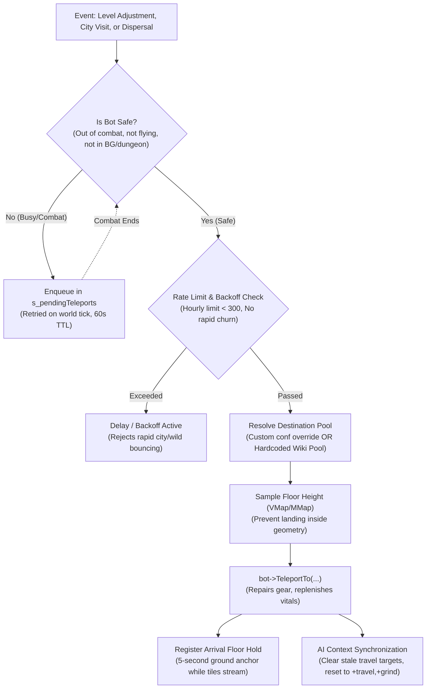

# Turtle WoW Bot Level Brackets: Teleportation System & Destination Catalog

This guide provides an authoritative reference for the teleportation, dispersal, and city visit subsystems in `mod-twow-bot-level-brackets`, accompanied by the complete directory of coordinates for all 7 level brackets across Eastern Kingdoms, Kalimdor, and Turtle WoW custom zones.

---

## 1. How the Teleportation System Works

The teleportation engine is designed to feel completely organic to players while maintaining rock-solid server performance and bot AI stability.



### Core Architecture Pillars:
1. **Asynchronous In-Combat & Flight Protection Queue (`s_pendingTeleports`)**:
   - Bots engaged in combat, flying on flight masters, dueling, or in battlegrounds are never rudely interrupted or dropped from mid-air.
   - The module automatically defers the teleport request to a thread-safe pending queue. When the bot drops combat and returns to an idle outdoor state, the deferred teleport is executed seamlessly.
   - Pending requests carry a 60-second TTL to avoid stale queue buildup.
2. **Anti-Ping-Pong Early Departure Backoff**:
   - To eliminate "teleport thrashing" (where conflicting bot objectives cause a bot to rapidly bounce back and forth between a capital city and the wilderness), the system enforces an early departure backoff.
   - If a bot attempts another relocation within 30 seconds of landing, a 120-second backoff penalty is applied to that bot.
3. **Rolling Window Hourly Rate Limiting**:
   - A rolling 1-hour window throttles mass relocation events (capped at 300 per hour by default) to protect the server from latency spikes during large rebalancing passes or server restarts.
4. **VMap / MMap Floor Sampling (`SampleFloorHeight`)**:
   - Teleport destinations are dynamically validated against actual map height maps (`map->GetHeight`) within a ±25 yard search radius to prevent bots from spawning beneath terrain or inside world geometry.
5. **Anti-Fall Arrival Floor Hold (`RegisterArrivalFloor`)**:
   - Upon landing, the bot is registered with a temporary arrival floor anchor (5 seconds default). If the client or server experiences delayed WMO/terrain streaming, the anti-fall mechanism catches the bot and prevents falling through world objects.
6. **Full Playerbot AI Synchronization**:
   - Unlike raw teleport commands, `mod-twow-bot-level-brackets` coordinates directly with the `TortoiseBots` companion engine:
     - **TravelTarget Invalidation**: Nullifies and expires stale `TravelTarget` instances in `sTravelMgr` so the bot does not attempt to path hundreds of miles back across continents to its previous quest objective.
     - **Strategy Realignment**: Strips city errands (`-rpg, -rpg quest, -rpg vendor`) and engages outdoor survival strategies (`+travel, +grind`).
     - **Action Dispatch**: Fired via `PlayerbotAI::DoSpecificAction("choose travel target")` to immediately orient the bot to local quest hubs and creature grinding spots.
7. **Equipment Maintenance & Vital Restoration**:
   - Bots receive complete durability repairs (`DurabilityRepairAll`) and full health/power restoration upon arriving in their new level bracket.

---

## 2. Master Destination Directory by Level Bracket

All coordinates are extracted directly from official Turtle WoW server database tables (`tw_world_game_tele.sql`, `tw_world_taxi_nodes.sql`, and `tw_world_creature.sql`).

### Bracket 0: Levels 1–9 (Starter Valleys & Racial Starting Zones)

#### Alliance
| Zone | Settlement / Landmark | Map ID | X | Y | Z | Orientation | Faction |
| :--- | :--- | :---: | :---: | :---: | :---: | :---: | :---: |
| **Elwynn Forest** | Northshire Valley | 0 | -8921.09 | -119.14 | 82.20 | 5.83 | Human |
| **Elwynn Forest** | Goldshire | 0 | -9448.55 | 68.24 | 56.32 | 2.11 | Human |
| **Dun Morogh** | Coldridge Valley | 0 | -6231.77 | 332.99 | 383.17 | 0.48 | Dwarf / Gnome |
| **Dun Morogh** | Kharanos | 0 | -5597.31 | -483.40 | 396.98 | 3.18 | Dwarf / Gnome |
| **Dun Morogh** | Brewnall Village | 0 | -5385.04 | 310.28 | 394.15 | 5.20 | Dwarf / Gnome |
| **Teldrassil** | Shadowglen | 1 | 10334.00 | 833.90 | 1326.11 | 3.62 | Night Elf |
| **Teldrassil** | Dolanaar | 1 | 9848.37 | 966.95 | 1306.38 | 3.77 | Night Elf |
| **Thalassian Highlands** | High Elf Academy | 0 | 3321.97 | -2447.81 | 107.18 | 3.47 | High Elf (TWoW) |
| **Thalassian Highlands** | Thalassian Highlands Outskirts | 0 | 3625.95 | -2434.33 | 67.09 | 0.07 | High Elf (TWoW) |
| **Thalassian Highlands** | Alah'Thalas Approach | 0 | 4321.99 | -2806.02 | 5.10 | 3.14 | High Elf (TWoW) |

#### Horde
| Zone | Settlement / Landmark | Map ID | X | Y | Z | Orientation | Faction |
| :--- | :--- | :---: | :---: | :---: | :---: | :---: | :---: |
| **Durotar** | Valley of Trials | 1 | -601.29 | -4296.76 | 37.81 | 1.65 | Orc / Troll |
| **Durotar** | Razor Hill | 1 | 326.81 | -4706.65 | 15.37 | 4.16 | Orc / Troll |
| **Durotar** | Sen'jin Village | 1 | -828.00 | -4927.10 | 20.16 | 1.58 | Troll |
| **Tirisfal Glades** | Deathknell | 0 | 1843.50 | 1590.00 | 93.30 | 3.09 | Undead |
| **Tirisfal Glades** | Brill | 0 | 2259.25 | 290.43 | 34.11 | 0.99 | Undead |
| **Mulgore** | Camp Narache | 1 | -2919.35 | -264.54 | 53.62 | 0.41 | Tauren |
| **Mulgore** | Bloodhoof Village | 1 | -2240.91 | -399.17 | -9.42 | 2.53 | Tauren |
| **Blackstone Island** | Goblin Landing Pod | 1 | -275.60 | -7474.59 | 73.19 | 2.51 | Goblin (TWoW) |
| **Blackstone Island** | Gazzik's Workshop | 1 | -570.74 | -7849.85 | 52.11 | 2.51 | Goblin (TWoW) |

---

### Bracket 1: Levels 10–19 (Early Open-World Towns & Contested Hubs)

#### Alliance
| Zone | Settlement / Village | Map ID | X | Y | Z | Orientation | Notes |
| :--- | :--- | :---: | :---: | :---: | :---: | :---: | :--- |
| **Westfall** | Sentinel Hill | 0 | -10624.50 | 1096.66 | 33.76 | 1.31 | Town Center |
| **Westfall** | Saldean's Farm | 0 | -10128.70 | 1055.21 | 36.43 | 2.44 | Farmer Saldean |
| **Westfall** | Moonbrook | 0 | -10986.70 | 1542.75 | 44.79 | 2.62 | Defias Outskirts |
| **Loch Modan** | Thelsamar | 0 | -5352.54 | -2948.53 | 323.78 | 5.34 | Main Hub |
| **Loch Modan** | Farstrider Lodge | 0 | -5650.46 | -4290.58 | 407.81 | 2.03 | Outpost |
| **Darkshore** | Auberdine | 1 | 6376.26 | 558.12 | 15.11 | 2.59 | Port Town |
| **The Barrens** *(B)* | Ratchet | 1 | -956.66 | -3754.71 | 5.33 | 1.00 | Neutral Port (Contested) |
| **Redridge Mountains** | Lakeshire | 0 | -9266.59 | -2188.77 | 64.09 | 2.10 | Level 15+ Hub |
| **Wetlands** | Menethil Harbor | 0 | -3769.32 | -744.26 | 8.01 | 1.96 | Level 15+ Harbor |

#### Horde
| Zone | Settlement / Village | Map ID | X | Y | Z | Orientation | Notes |
| :--- | :--- | :---: | :---: | :---: | :---: | :---: | :--- |
| **The Barrens** *(B)* | The Crossroads | 1 | -452.84 | -2650.76 | 95.52 | 0.24 | Central Hub |
| **The Barrens** *(B)* | Camp Taurajo | 1 | -2363.11 | -1913.78 | 95.78 | 0.17 | Southern Barrens |
| **The Barrens** *(B)* | Ratchet | 1 | -956.66 | -3754.71 | 5.33 | 1.00 | Neutral Port |
| **Silverpine Forest** | The Sepulcher | 0 | 504.53 | 1539.08 | 129.50 | 1.36 | Main Forsaken Base |
| **Silverpine Forest** | Pyrewood Village Outskirts | 0 | -388.15 | 1543.67 | 18.16 | 3.10 | Southern Silverpine |
| **Durotar** | Razor Hill | 1 | 326.81 | -4706.65 | 15.37 | 4.16 | Eastern Staging Hub |
| **Ashenvale** *(B)* | Splintertree Post | 1 | 2270.94 | -2538.19 | 93.92 | 0.06 | Level 15+ Ashenvale Border |

---

### Bracket 2: Levels 20–29 (Contested Fronts & Regional Strongholds)

#### Alliance
| Zone | Settlement / Village | Map ID | X | Y | Z | Orientation | Notes |
| :--- | :--- | :---: | :---: | :---: | :---: | :---: | :--- |
| **Redridge Mountains** | Lakeshire | 0 | -9266.59 | -2188.77 | 64.09 | 2.10 | Town Center |
| **Duskwood** | Darkshire | 0 | -10573.00 | -1182.51 | 28.01 | 0.31 | Town Center |
| **Duskwood** | Raven Hill | 0 | -10742.20 | 330.57 | 38.25 | 0.55 | Western Duskwood |
| **Wetlands** | Menethil Harbor | 0 | -3769.32 | -744.26 | 8.01 | 1.96 | Main Port |
| **Wetlands** | Dun Agrath | 0 | -3951.50 | -1331.74 | 148.73 | 4.36 | Eastern Outpost (TWoW) |
| **Ashenvale** *(B)* | Astranaar | 1 | 2676.19 | -422.91 | 107.12 | 0.65 | Alliance Stronghold |
| **Stonetalon Mountains** *(B)*| Stonetalon Peak | 1 | 2678.38 | 1497.46 | 233.87 | 6.26 | Night Elf Hub |
| **Stonetalon Mountains** *(B)*| Bael Hardul | 1 | 875.28 | -836.36 | 170.90 | 0.00 | Dwarven Excavation (TWoW) |
| **Hillsbrad Foothills** *(B)* | Southshore | 0 | -853.22 | -533.53 | 9.99 | 0.24 | Alliance Town |
| **Thousand Needles** *(B)* | Thalanaar | 1 | -4491.88 | -775.89 | -39.52 | 0.00 | Northern Outpost |
| **Thousand Needles** *(B)* | Mirage Raceway | 1 | -6221.35 | -3927.64 | -58.75 | 0.76 | Shimmering Flats |
| **Balor** *(B - TWoW)* | SI:7 Outpost | 0 | -9199.12 | 2573.07 | 9.50 | 0.40 | Turtle WoW Custom Isle |

#### Horde
| Zone | Settlement / Village | Map ID | X | Y | Z | Orientation | Notes |
| :--- | :--- | :---: | :---: | :---: | :---: | :---: | :--- |
| **The Barrens** *(B)* | Camp Taurajo | 1 | -2363.11 | -1913.78 | 95.78 | 0.17 | Southern Barrens |
| **Ashenvale** *(B)* | Splintertree Post | 1 | 2270.94 | -2538.19 | 93.92 | 0.06 | Main Horde Base |
| **Ashenvale** *(B)* | Zoram'gar Outpost | 1 | 3374.71 | 996.97 | 5.19 | 3.82 | Zoram Strand Base |
| **Stonetalon Mountains** *(B)*| Sun Rock Retreat | 1 | 966.15 | 926.50 | 104.65 | 1.27 | Tauren Sanctuary |
| **Stonetalon Mountains** *(B)*| Malaka'jin | 1 | 1570.92 | 1031.52 | 137.96 | 3.33 | Troll Outpost |
| **Hillsbrad Foothills** *(B)* | Tarren Mill | 0 | -34.15 | -923.37 | 54.56 | 0.15 | Horde Town |
| **Hillsbrad Foothills** *(B)* | Durnholde Keep | 0 | 32.55 | -676.68 | 127.35 | 4.29 | Syndicate Outskirts |
| **Thousand Needles** *(B)* | Freewind Post | 1 | -5431.78 | -2449.38 | 89.28 | 2.33 | Tauren Mesa City |
| **Thousand Needles** *(B)* | Mirage Raceway | 1 | -6221.35 | -3927.64 | -58.75 | 0.76 | Shimmering Flats |
| **Balor** *(B - TWoW)* | Stormbreaker Point | 0 | -9180.10 | 2573.64 | 9.47 | 0.40 | Balor Horde Camp (TWoW) |

---

### Bracket 3: Levels 30–39 (Contested Warfare, Islands & Gilneas)

#### Alliance
| Zone | Settlement / Village | Map ID | X | Y | Z | Orientation | Notes |
| :--- | :--- | :---: | :---: | :---: | :---: | :---: | :--- |
| **Arathi Highlands** *(B)* | Refuge Pointe | 0 | -1246.61 | -2529.32 | 20.61 | 0.74 | Main Alliance Stronghold |
| **Alterac Mountains** *(B)*| Sofera's Nook / Border | 0 | 370.76 | -491.36 | 175.36 | 5.38 | Mountain Approach |
| **Desolace** *(B)* | Nijel's Point | 1 | 139.24 | 1325.82 | 193.50 | 0.56 | Northern Valley Base |
| **Stranglethorn Vale** *(B)* | Rebel Camp | 0 | -11322.40 | -202.49 | 75.64 | 0.43 | Northern STV Hub |
| **Stranglethorn Vale** *(B)* | Booty Bay | 0 | -14297.20 | 530.99 | 8.78 | 3.99 | Goblin Port |
| **Dustwallow Marsh** *(B)* | Theramore Isle | 1 | -3641.30 | -4358.93 | 8.35 | 3.82 | Proudmoore Stronghold |
| **Swamp of Sorrows** *(B)* | Misty Reed Strand | 0 | -10345.40 | -2773.42 | 21.99 | 5.08 | Coastal Approach |
| **Badlands** *(B)* | Mirage Flats / Angor | 0 | -6779.20 | -3423.64 | 241.67 | 0.65 | Northern Badlands |
| **Gilneas** *(B - TWoW)* | Ravenshire | 0 | -2165.31 | 974.40 | 2.22 | 2.72 | Alliance Village (TWoW) |
| **Gilneas** *(B - TWoW)* | Gilneas City | 815 | -1095.44 | 2234.75 | 182.86 | 2.60 | Custom City Instance |

#### Horde
| Zone | Settlement / Village | Map ID | X | Y | Z | Orientation | Notes |
| :--- | :--- | :---: | :---: | :---: | :---: | :---: | :--- |
| **Arathi Highlands** *(B)* | Hammerfall | 0 | -941.01 | -3526.66 | 70.94 | 3.49 | Main Horde Stronghold |
| **Alterac Mountains** *(B)*| Strahnbrad / Alterac | 0 | 370.76 | -491.36 | 175.36 | 5.38 | Syndicate Ruins |
| **Desolace** *(B)* | Ghost Walker Post | 1 | -1224.46 | 1728.53 | 90.06 | 0.83 | Tauren Post |
| **Desolace** *(B)* | Shadowprey Village | 1 | -1664.79 | 3091.67 | 30.56 | 6.08 | Troll Fishing Port |
| **Stranglethorn Vale** *(B)* | Grom'gol Base Camp | 0 | -12414.20 | 146.29 | 3.28 | 1.92 | Zeppelin Fort |
| **Stranglethorn Vale** *(B)* | Booty Bay | 0 | -14297.20 | 530.99 | 8.78 | 3.99 | Goblin Port |
| **Dustwallow Marsh** *(B)* | Brackenwall Village | 1 | -3130.67 | -2908.43 | 34.10 | 1.43 | Ogre Village |
| **Dustwallow Marsh** *(B)* | Mudsprocket | 1 | -4569.57 | -3222.49 | 34.92 | 0.00 | Goblin Outpost (TWoW) |
| **Swamp of Sorrows** *(B)* | Stonard | 0 | -10446.90 | -3261.91 | 20.18 | 5.02 | Orcish Fortress |
| **Badlands** *(B)* | Kargath | 0 | -6692.48 | -2175.31 | 244.15 | 0.43 | Horde Outpost |
| **Gilneas** *(B - TWoW)* | Stillward Church | 0 | -1300.59 | 1160.95 | 126.86 | 2.72 | Forsaken Outpost (TWoW) |
| **Gilneas** *(B - TWoW)* | Gilneas City | 815 | -1095.44 | 2234.75 | 182.86 | 2.60 | Custom City Instance |

---

### Bracket 4: Levels 40–49 (Frontier Outposts & Custom Islands)

#### Alliance
| Zone | Settlement / Village | Map ID | X | Y | Z | Orientation | Notes |
| :--- | :--- | :---: | :---: | :---: | :---: | :---: | :--- |
| **The Hinterlands** *(B)* | Aerie Peak | 0 | 260.37 | -2125.21 | 119.57 | 3.18 | Wildhammer Dwarf Capital |
| **Feralas** *(B)* | Feathermoon Stronghold | 1 | -4317.47 | 3287.35 | 18.29 | 3.13 | Island Stronghold |
| **Tanaris** *(B)* | Gadgetzan | 1 | -7177.15 | -3785.34 | 8.37 | 6.10 | Steamwheedle Capital |
| **Searing Gorge** *(B)* | Thorium Point | 0 | -6506.47 | -1149.95 | 307.71 | 4.18 | Thorium Brotherhood Hub |
| **Blasted Lands** *(B)* | Nethergarde Keep | 0 | -10999.80 | -3380.08 | 62.25 | 4.64 | Fortress Tower |
| **Azshara** *(B)* | Talrendis Point | 1 | 2735.06 | -3867.44 | 98.65 | 3.56 | Night Elf Outpost |
| **Lapidis Isle** *(B - TWoW)*| Caelan's Rest | 0 | -11864.90 | 3188.40 | 20.00 | 0.19 | Alliance Base (TWoW) |
| **Icepoint Rock** *(B - TWoW)*| Icepoint Rock | 1 | 13675.00 | -6593.94 | 3.04 | 0.88 | Frozen Offshore Rock |
| **Desolace / Maraudon** *(B)*| Valley of the Centaur | 1 | -1419.13 | 2908.14 | 137.46 | 1.57 | Maraudon Exterior Valley |

#### Horde
| Zone | Settlement / Village | Map ID | X | Y | Z | Orientation | Notes |
| :--- | :--- | :---: | :---: | :---: | :---: | :---: | :--- |
| **The Hinterlands** *(B)* | Revantusk Village | 0 | -557.23 | -4581.27 | 9.59 | 1.02 | Forest Troll Coastal Port |
| **Feralas** *(B)* | Camp Mojache | 1 | -4396.70 | 224.84 | 25.41 | 4.94 | Main Horde Base |
| **Tanaris** *(B)* | Gadgetzan | 1 | -7177.15 | -3785.34 | 8.37 | 6.10 | Steamwheedle Capital |
| **Searing Gorge** *(B)* | Thorium Point | 0 | -6506.47 | -1149.95 | 307.71 | 4.18 | Thorium Brotherhood Hub |
| **Blasted Lands** *(B)* | Dreadmaul Hold | 0 | -11182.50 | -3016.67 | 7.42 | 4.00 | Ogre / Orcish Post |
| **Azshara** *(B)* | Valormok | 1 | 3608.59 | -4414.43 | 113.05 | 1.62 | Horde Mountain Post |
| **Gillijim's Isle** *(B - TWoW)*| Maul'Ogg Refuge | 0 | -14087.20 | 2269.20 | 67.00 | 1.29 | Ogre Outpost (TWoW) |
| **Icepoint Rock** *(B - TWoW)*| Icepoint Rock | 1 | 13675.00 | -6593.94 | 3.04 | 0.88 | Frozen Offshore Rock |
| **Desolace / Maraudon** *(B)*| Valley of the Centaur | 1 | -1419.13 | 2908.14 | 137.46 | 1.57 | Maraudon Exterior Valley |

---

### Bracket 5: Levels 50–59 (Endgame Approaches, Plaguelands & Tel'Abim)

#### Alliance
| Zone | Settlement / Village | Map ID | X | Y | Z | Orientation | Notes |
| :--- | :--- | :---: | :---: | :---: | :---: | :---: | :--- |
| **Western Plaguelands** *(B)*| Chillwind Camp | 0 | 931.32 | -1430.11 | 64.67 | 0.00 | Main Alliance Front |
| **Eastern Plaguelands** *(B)*| Light's Hope Chapel | 0 | 2289.89 | -5281.52 | 82.13 | 4.55 | Argent Dawn Stronghold |
| **Felwood** *(B)* | Talonbranch Glade | 1 | 6205.88 | -1949.63 | 571.29 | 0.00 | Northern Night Elf Post |
| **Felwood** *(B)* | Emerald Sanctuary | 1 | 3986.71 | -1293.58 | 250.14 | 5.75 | Southern Druid Sanctuary |
| **Burning Steppes** *(B)* | Morgan's Vigil | 0 | -8364.61 | -2738.35 | 185.46 | 3.43 | Southern Watchtower |
| **Un'Goro Crater** *(B)* | Marshal's Refuge | 1 | -6113.82 | -1142.70 | -187.63 | 0.71 | Northern Crystal Cave |
| **Winterspring** *(B)* | Everlook | 1 | 6725.69 | -4619.44 | 720.91 | 4.67 | Goblin Outpost |
| **Silithus** *(B)* | Cenarion Hold | 1 | -6818.09 | 733.81 | 41.57 | 2.31 | Cenarion Circle Fort |
| **Tel'Abim** *(B - TWoW)* | Tel Co. Basecamp | 1 | -8892.64 | -6455.32 | 7.80 | 1.53 | Tropical Isle (TWoW) |
| **Mount Hyjal** *(B - TWoW)* | Nordanaar | 1 | 5497.70 | -3690.70 | 1594.21 | 2.88 | Hyjal Mountain Hub |
| **Blackrock Mountain** *(B)*| Mountain Entrance | 0 | -7494.94 | -1123.49 | 265.55 | 3.31 | BRD / BRS Approach |
| **Moonglade** *(B)* | Nighthaven | 1 | 7654.30 | -2232.87 | 462.11 | 5.97 | Neutral Druid Sanctuary |
| **Deadwind Pass** *(B)* | Deadwind Pass Approach | 0 | -10438.80 | -1932.75 | 104.62 | 4.77 | Karazhan Approach |

#### Horde
| Zone | Settlement / Village | Map ID | X | Y | Z | Orientation | Notes |
| :--- | :--- | :---: | :---: | :---: | :---: | :---: | :--- |
| **Western Plaguelands** *(B)*| The Bulwark | 0 | 1711.99 | -719.76 | 54.34 | 4.66 | Forsaken Gatehouse |
| **Eastern Plaguelands** *(B)*| Light's Hope Chapel | 0 | 2289.89 | -5281.52 | 82.13 | 4.55 | Argent Dawn Stronghold |
| **Felwood** *(B)* | Bloodvenom Post | 1 | 5128.91 | -343.51 | 355.04 | 3.39 | Main Horde Camp |
| **Felwood** *(B)* | Emerald Sanctuary | 1 | 3986.71 | -1293.58 | 250.14 | 5.75 | Southern Druid Sanctuary |
| **Burning Steppes** *(B)* | Flame Crest | 0 | -7501.51 | -2183.08 | 165.93 | 6.07 | Northern Mountain Camp |
| **Un'Goro Crater** *(B)* | Marshal's Refuge | 1 | -6113.82 | -1142.70 | -187.63 | 0.71 | Northern Crystal Cave |
| **Winterspring** *(B)* | Everlook | 1 | 6725.69 | -4619.44 | 720.91 | 4.67 | Goblin Outpost |
| **Silithus** *(B)* | Cenarion Hold | 1 | -6818.09 | 733.81 | 41.57 | 2.31 | Cenarion Circle Fort |
| **Tel'Abim** *(B - TWoW)* | Tel Co. Basecamp | 1 | -8892.64 | -6455.32 | 7.80 | 1.53 | Tropical Isle (TWoW) |
| **Mount Hyjal** *(B - TWoW)* | Nordanaar | 1 | 5497.70 | -3690.70 | 1594.21 | 2.88 | Hyjal Mountain Hub |
| **Blackrock Mountain** *(B)*| Mountain Entrance | 0 | -7494.94 | -1123.49 | 265.55 | 3.31 | BRD / BRS Approach |
| **Moonglade** *(B)* | Nighthaven | 1 | 7654.30 | -2232.87 | 462.11 | 5.97 | Neutral Druid Sanctuary |
| **Deadwind Pass** *(B)* | Deadwind Pass Approach | 0 | -10438.80 | -1932.75 | 104.62 | 4.77 | Karazhan Approach |

---

### Bracket 6: Level 60 (Endgame Maximum Level Hubs & Raids)

#### Alliance
| Zone | Settlement / Landmark | Map ID | X | Y | Z | Orientation | Notes |
| :--- | :--- | :---: | :---: | :---: | :---: | :---: | :--- |
| **Western Plaguelands** | Chillwind Camp | 0 | 931.32 | -1430.11 | 64.67 | 0.00 | Scholomance Staging |
| **Eastern Plaguelands** | Light's Hope Chapel | 0 | 2289.89 | -5281.52 | 82.13 | 4.55 | Stratholme / Naxxramas |
| **Burning Steppes** | Morgan's Vigil | 0 | -8364.61 | -2738.35 | 185.46 | 3.43 | Blackrock Mountain |
| **Searing Gorge** | Thorium Point | 0 | -6506.47 | -1149.95 | 307.71 | 4.18 | Molten Core Staging |
| **Silithus** | Cenarion Hold | 1 | -6818.09 | 733.81 | 41.57 | 2.31 | Ahn'Qiraj Staging |
| **Winterspring** | Everlook | 1 | 6725.69 | -4619.44 | 720.91 | 4.67 | High Level Grinding |
| **Un'Goro Crater** | Marshal's Refuge | 1 | -6113.82 | -1142.70 | -187.63 | 0.71 | Elemental Grinding |
| **Tel'Abim** | Tel Co. Basecamp | 1 | -8892.64 | -6455.32 | 7.80 | 1.53 | Turtle WoW Custom |
| **Mount Hyjal** | Nordanaar | 1 | 5497.70 | -3690.70 | 1594.21 | 2.88 | World Boss / Hyjal |
| **Blackrock Mountain** | Mountain Entrance | 0 | -7494.94 | -1123.49 | 265.55 | 3.31 | BRD / BRS Approach |
| **Moonglade** | Nighthaven | 1 | 7654.30 | -2232.87 | 462.11 | 5.97 | Neutral Druid Sanctuary |
| **Deadwind Pass** | Deadwind Pass Approach | 0 | -10438.80 | -1932.75 | 104.62 | 4.77 | Karazhan Approach |

#### Horde
| Zone | Settlement / Landmark | Map ID | X | Y | Z | Orientation | Notes |
| :--- | :--- | :---: | :---: | :---: | :---: | :---: | :--- |
| **Western Plaguelands** | The Bulwark | 0 | 1711.99 | -719.76 | 54.34 | 4.66 | Scholomance Staging |
| **Eastern Plaguelands** | Light's Hope Chapel | 0 | 2289.89 | -5281.52 | 82.13 | 4.55 | Stratholme / Naxxramas |
| **Burning Steppes** | Flame Crest | 0 | -7501.51 | -2183.08 | 165.93 | 6.07 | Blackrock Mountain |
| **Searing Gorge** | Thorium Point | 0 | -6506.47 | -1149.95 | 307.71 | 4.18 | Molten Core Staging |
| **Silithus** | Cenarion Hold | 1 | -6818.09 | 733.81 | 41.57 | 2.31 | Ahn'Qiraj Staging |
| **Winterspring** | Everlook | 1 | 6725.69 | -4619.44 | 720.91 | 4.67 | High Level Grinding |
| **Un'Goro Crater** | Marshal's Refuge | 1 | -6113.82 | -1142.70 | -187.63 | 0.71 | Elemental Grinding |
| **Tel'Abim** | Tel Co. Basecamp | 1 | -8892.64 | -6455.32 | 7.80 | 1.53 | Turtle WoW Custom |
| **Mount Hyjal** | Nordanaar | 1 | 5497.70 | -3690.70 | 1594.21 | 2.88 | World Boss / Hyjal |
| **Blackrock Mountain** | Mountain Entrance | 0 | -7494.94 | -1123.49 | 265.55 | 3.31 | BRD / BRS Approach |
| **Moonglade** | Nighthaven | 1 | 7654.30 | -2232.87 | 462.11 | 5.97 | Neutral Druid Sanctuary |
| **Deadwind Pass** | Deadwind Pass Approach | 0 | -10438.80 | -1932.75 | 104.62 | 4.77 | Karazhan Approach |

---

## 3. Capital City Landing Targets

Bots visiting capital cities land at the canonical `.teleport <city>` entry coordinates resolved dynamically from `sObjectMgr.GetGameTele()`:

| Capital City | Faction | Primary Entry Location | Alternate Bank Fallback |
| :--- | :---: | :--- | :--- |
| **Stormwind City** | Alliance | City Gates (`-8913.23, 554.63, 93.79`) | Trade District Bank Tile (`-8833.38, 628.62, 94.09`) |
| **Ironforge** | Alliance | Ironforge Gates (`-4918.88, -940.40, 501.55`) | The Commons Bank Tile (`-4918.88, -940.40, 501.55`) |
| **Darnassus** | Alliance | Temple Garden Entrance (`9947.52, 2482.73, 1316.21`) | Bank of Darnassus (`9947.52, 2482.73, 1316.21`) |
| **Alah'Thalas** *(TWoW)* | Alliance | Grand Spire Portal (`3180.25, -3450.15, 138.80`) | Sunstrider Promenade (`3180.25, -3450.15, 138.80`) |
| **Orgrimmar** | Horde | Valley of Strength Gates (`1633.00, -4439.11, 15.76`) | Valley of Strength Bank (`1633.00, -4439.11, 15.76`) |
| **Undercity** | Horde | Courtyard Entrance (`1633.33, 240.22, -43.10`) | Apothecarium / Central Bank (`1633.33, 240.22, -43.10`) |
| **Thunder Bluff** | Horde | Central Lift Landing (`-1277.37, 117.21, 131.00`) | Lower Rise Bank (`-1277.37, 117.21, 131.00`) |
| **Sparkwater Port** *(TWoW)* | Horde | Docks / Landing Pod (`-1190.00, -3740.00, 12.50`) | Goblin Exchange (`-1190.00, -3740.00, 12.50`) |

---

## 4. Custom Configuration Overrides

Administrators can override the hardcoded Wiki pools by setting custom comma-separated destination pools in `mod_twow_bot_level_brackets.conf`. 

Entries may be specified by **GameTele name** (e.g., `goldshire`, `sentinelhill`, `thecrossroads`) or as raw **`map,x,y,z,o` coordinates**:

```ini
# Example: Alliance Level 10-19 custom destination pool
BotLevelBrackets.Alliance.TeleportLocation.LevelRange.1 = "sentinelhill,thelsamar,auberdine,0,-10128.7,1055.21,36.43,2.44"

# Example: Horde Level 20-29 custom destination pool
BotLevelBrackets.Horde.TeleportLocation.LevelRange.2 = "thecrossroads,camptaurajo,tarrenmill,splintertreepost"
```
When configured, the module automatically parses the pool, resolves aliases against `sObjectMgr.GetGameTele()`, and picks randomly among them upon level adjustment or dispersal.
