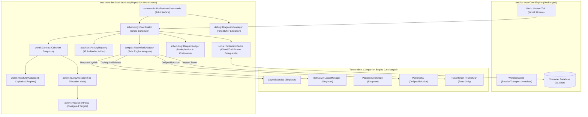

# Architecture Specification: Bot Level Brackets (`mod-twow-bot-level-brackets`)

> **Target Platform**: Turtle WoW Custom vMaNGOS (`tortoise-wow` 1.18.1.7272 / 1.12.1)  
> **Target Bot Engine**: `TortoiseBots` (Native Modular Companion Engine) & Legacy CMaNGOS PlayerBots  
> **Architecture Pattern**: Native-Task Population Orchestrator (Brackets Orchestrates; Unchanged Playerbots Executes)  
> **Status**: Authoritative Reference Specification  
> **Compliance**: Strict adherence to The Unediting Doctrine (zero changes to `tortoise-wow` and `TortoiseBots`)

---

## 1. System Overview & Orchestration Mandate

Under this architecture, the native `Playerbots` engine owns all gameplay tasks, route calculations, combat, questing, grinding, economy, and physical movement. The `mod-twow-bot-level-brackets` module acts exclusively as an external population observer, quota authority, and scheduler. It identifies deficits and requests **already implemented native tasks** through verified public entry points without modifying the engine or registering custom AI types.

### Architectural Invariants:
1. **The Unediting Doctrine**: Zero modifications to core sources (`tortoise-wow`) or bot engine sources (`TortoiseBots`).
2. **Zero Augmentation Seams**: No `RegisterAiContextAugmenter`, no custom AI strategies/actions/triggers/values registered in engine context.
3. **Zero Relocation / Mutation**: Zero `Player::TeleportTo` calls, zero direct level mutations, zero synthetic XP, zero factory re-provisioning.
4. **Honest Capability Reporting**: Exact destination control is used only when verified native APIs accept and enforce it. Missing capabilities report shortages truthfully rather than pretending to enforce them.

---

## 2. Component Architecture & Layered Responsibilities

| Subsystem | Source Location | Core Responsibility |
|:---|:---|:---|
| **`NativeTaskAdapter`** | `src/compat/` | Narrow, typed wrapper for verified native public request APIs (`CityVisitService::RequestVisit`, `PlayerbotAI::DoSpecificAction`). Preserves native admission gates. |
| **`PopulationPolicy`** | `src/policy/` | Central container for desired city allocations, outdoor targets, dynamic human weights, and destination policies. |
| **`QuotaAllocator`** | `src/policy/` | Pure mathematical evaluation of quotas, bounded min/max clamping, field reserve limits, and shortfall calculations. |
| **`ReadOnlyCatalog`** | `src/world/` | Immutable reference definitions for the 8 Turtle WoW racial capitals (SW, IF, Darn, Alah; Org, UC, TB, Spark) and outdoor zones. |
| **`Census`** | `src/world/` | Coherent point-in-time snapshots of online bots, actual physical residents, confirmed inbound, pending reservations, and shortages. |
| **`Coordinator`** | `src/scheduling/` | Unified admission and scheduling authority. Runs on world update tick, prevents GUID bias, enforces shared caps, and dispatches tasks. |
| **`RequestLedger`** | `src/scheduling/` | In-memory ledger tracking requests across states (`Proposed`, `Submitted`, `NativeAccepted`, `Arrived`, `Released`, `Rejected`). Enforces deduplication. |
| **`ActivityRegistry`** | `src/activities/` | Typed schema and configuration for 42 audited native activities with support class classification. |
| **`ProtectionCache`** | `src/social/` | Multi-tier safeguard caching player friends, real-player guilds, and excluded bot names. Fail-closed on DB errors. |
| **`BotBracketsCommands`** | `src/commands/` | Secured `.blb` commands (`status`, `cities`, `world`, `brackets`, `activities`, `ledger`, `stats`, `explain`, `reload`, `force`, `cleanup`, `debug`). |
| **`DiagnosticManager`** | `src/debug/` | Bounded diagnostic event ring buffer, rate limiting, and DryRun mode simulation. |

---

## 3. Quota Allocation & Mathematical Model

The module ensures fair, deterministic quota allocations using largest-remainder apportionment:
1. **Raw Target Calculation**:
   - QuotaMode 1: $\text{RawTarget} = \text{FixedCount}$
   - QuotaMode 2: $\text{RawTarget} = \lfloor \frac{\text{FactionTotal} \times \text{ConfiguredPct} + 50}{100} \rfloor$
2. **Min/Max Boundary Clamping**:
   - Enforces configurable min and max headcounts or percentages.
3. **Field Reserve Boundary**:
   - Caps total city allocations so that at least `FieldReservePct` (default: 70%) of the bot population remains in the open world:
     $$\text{FeasibleTarget} = \min(\text{BoundedTarget}, \lfloor \frac{\text{FactionTotal} \times (100 - \text{FieldReservePct}) + 50}{100} \rfloor)$$
4. **Actionable Shortfall**:
   $$\text{Effective} = \text{ActualResidents} + \text{ConfirmedInbound} + \text{PendingReservations}$$
   $$\text{Shortfall} = \max(0, \text{FeasibleTarget} - \text{Effective})$$
5. **Level Distribution Shortages (Advisory)**:
   - Level distribution percentages across brackets (1-9, 10-19, 20-29, 30-39, 40-49, 50-59, 60) are observed and compared to desired targets.
   - Any bracket with insufficient bots displays an advisory shortfall; the engine is never altered to artificially level or reset characters.

---

## 4. Native Request Admission & Protection Pipeline

Before proposing any bot for a city or outdoor task, the coordinator enforces strict multi-tier gates:
1. **Autonomous Pool Bot Verification**:
   - `NativeTaskAdapter::IsFreeBot(bot)` confirms the bot is an autonomous wandering pool bot.
   - Bots with a real player master, hired bots, or bots grouped with real players are rejected immediately (`CityVisitAdmission::Protected`).
2. **Combat & State Safety**:
   - Bot must be alive, in the world, not in combat, not being teleported, and not inside a dungeon, raid, or battleground.
3. **Social Safeguards (`ProtectionCache`)**:
   - Excludes bots on real players' friends lists (`character_social`).
   - Excludes bots belonging to guilds containing real players (`guild_member`).
   - Excludes bots matching administrator-configured excluded names.
4. **Deduplication Barrier (`RequestLedger`)**:
   - Only 1 active task request per bot GUID is permitted across all domains.
   - Bots currently on cooldown (`RequestCooldownSeconds`, `RejectionBackoffSeconds`, `EarlyDepartureBackoffSeconds`) are skipped.
5. **Native Gate Preservation**:
   - Requests dispatched via `PlayerbotAI::DoSpecificAction` invoke `Engine::ExecuteAction`, which evaluates `action->isUseful()` and `action->isPossible()`.
   - If native need or feasibility fails, the action returns false without executing, and the module backs off safely.
