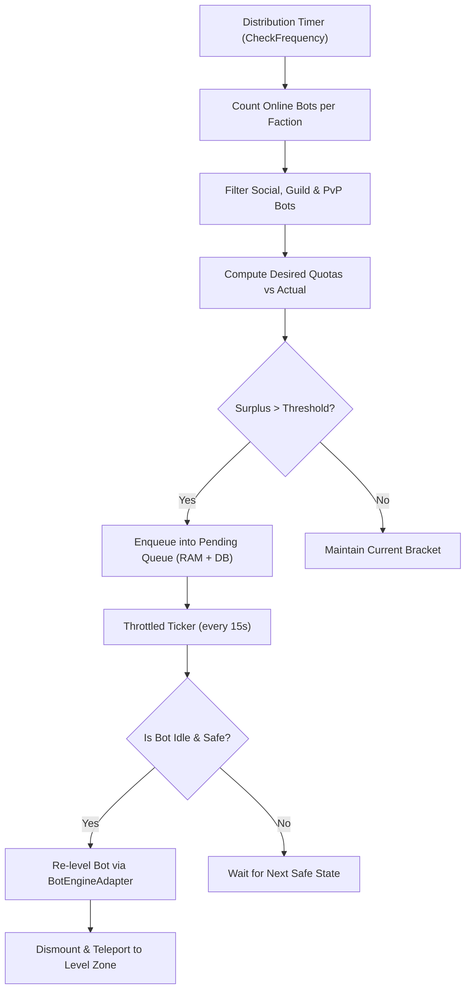

# Bot Level Brackets: Operator & Configuration Guide

**Module:** `mod-twow-bot-level-brackets`  
**Target Core:** Turtle WoW Custom vMaNGOS (`tortoise-wow` targeting client 1.18.1.7272 / 1.12.1)  
**Target Bot Engine:** `TortoiseBots` (native modular companion engine) & legacy CMaNGOS PlayerBots fallback  

---

## 1. Overview & Core Philosophy

The **Bot Level Brackets** module maintains a balanced, vibrant, and lore-friendly distribution of playerbots across the entire leveling spectrum of World of Warcraft.

In standard vanilla servers with playerbot systems enabled, bots frequently cluster at extreme ends—either stagnating at starting levels or accumulating at maximum level (60). This leaves the open world feeling deserted in mid-level zones, disrupts dungeon matchmaking, and trivializes world PvP.

This module automates the entire progression and world-presence lifecycle:
* **Bracket Balancing:** Periodically surveys online random bots and reallocates bots from overpopulated brackets to underpopulated brackets according to configured target quotas.
* **Dynamic Player Cluster Following:** Automatically adjusts bot populations to mirror where real human players are currently questing, ensuring leveling players always find companions and opponents.
* **Turtle WoW Native Integration:** Fully recognizes Turtle WoW's two custom playable races (**High Elves** and **Goblins**), their native starting zones (**Thalassian Highlands** and **Blackstone Island**), regional capital hubs (**Alah'Thalas** and **Sparkwater Port**), and custom open-world continents (**Gilneas**, **Tel'Abim**, **Lapidis Isle**).
* **Native Arena & PvP Protection:** Respects active PvP participation, safeguarding bots inside the **Blood Ring Arena** (Map 26), **Gurubashi Arena**, **Sunnyglade Valley** (Map 27), and Battleground queues from level modifications or sudden teleports.
* **Real Player Social Protection:** Completely exempts bots that are friends with real players, bots in guilds with human players (even when offline), bots grouped with real players, and bots commanded as masters.

---

## 2. How the Module Works

### 2.1 The Distribution Cycle

Every `BotLevelBrackets.CheckFrequency` seconds (default: 300s / 5 minutes), the module executes a distribution pass:

1. **Bot Census:** Counts all online random playerbots per faction (Alliance and Horde).
2. **Exclusion Filtering:** Excludes bots in guilds with real players, on real player friend lists, in active combat, in groups with real players, or in Arena/Battleground queues.
3. **Quota Calculation:** Computes the desired bot count for each bracket based on configured percentage allocations (or dynamic real-player clusters).
4. **Surplus Identification:** Calculates $\Delta = \text{Actual} - \text{Desired}$. If $\Delta > \text{MinBracketChangeThreshold}$, surplus bots are flagged for reassignment.
5. **Asynchronous Reset Queue:** Flagged bots are placed in a persistent queue (`bot_level_brackets_pending_resets`). A throttled background ticker re-levels bots in batches (`FlaggedProcessLimit = 5` every 15s) to limit work per pass; server latency must still be measured.
6. **Automated Dismount & Teleportation:** Once a bot is safely adjusted, it is dismounted (`bot->Unmount()`) and enqueued for teleportation directly to a level-appropriate questing hub.



---

### 2.2 Turtle WoW Arena & PvP Integration

Turtle WoW features a custom **Blood Ring Arena** on Map 26 alongside the classic **Gurubashi Arena** in Stranglethorn Vale. When `BotLevelBrackets.IgnoreArenaTeamBots` is enabled (`1`):
* Bots inside Blood Ring (`bot->InArena()`) or Gurubashi Arena (`bot->InGurubashiArena()`) are completely protected.
* Bots queued for Arenas or Battlegrounds (`bot->InBattleGroundQueue()`) will never be level-adjusted or teleported out.
* If a bot is already queued for a pending level reset and subsequently enters an Arena or Battleground, its pending reset is cancelled when the pending queue next checks its eligibility (or waits safely if the optional arena exclusion is disabled).

---

### 2.3 Capital Hub Ambiance & Dispersal (`HubPopulate`)

To keep major cities lively without draining the open world, the module supports **two quota calculation modes**:
* **Mode 1 (Total number):** Each city's existing `*Pct` setting is an absolute bot count (0–500). For example, `StormwindPct = 20` targets 20 bots.
* **Mode 2 (Percentage - Default):** Each city setting is a percentage (0–100) of online faction bots, rounded to the nearest bot.

`PopulationLimitsEnabled = 1` (default) bounds each nonzero city target between `MinBotsPerHub` and `MaxBotsPerHub` in both modes. Min `0` means no minimum; Max is never substituted as the refill goal. With Min `10`, Max `50`, a target of `20` stays `20`, `5` becomes `10`, and `70` becomes `50`. Set the toggle to `0` to ignore both bounds. A city setting of `0` remains disabled. With limits enabled, Max `0` targets empty hubs; Min above Max is clamped with a warning.

Both modes refill and disperse toward the resulting city target, subject to hysteresis, stability, cooldown, pending inbound accounting, cycle limits, eligibility and city level restrictions. Targets cannot exceed online faction bots. No bots are spawned; insufficient eligible bots can leave a city below its target. Limits count all brackets together.

In **Mode 2 (Default)**, quotas scale dynamically with server population up to the configured ceiling. For a typical faction of 100 bots, the default distribution keeps **20% of bots in capital cities** and **80% actively questing across the world**:

| Faction | Capital City | Map | Coordinates $(X, Y, Z)$ | Radius | Default % | For 100 Bots |
| :--- | :--- | :---: | :--- | :---: | :---: | :---: |
| **Alliance** | Stormwind City | 0 | `-8810.0, 640.0, 94.0` | 200m | **7%** | ~7 bots |
| **Alliance** | Ironforge | 0 | `-4980.0, -940.0, 501.0` | 150m | **5%** | ~5 bots |
| **Alliance** | Darnassus | 1 | `9950.0, 2330.0, 1330.0` | 150m | **4%** | ~4 bots |
| **Alliance** | **Alah'Thalas (High Elf)** | 0 | `3212.6, -2501.4, 111.7` | 180m | **4%** | ~4 bots |
| **Horde** | Orgrimmar | 1 | `1570.0, -4400.0, 8.0` | 200m | **7%** | ~7 bots |
| **Horde** | Undercity | 0 | `1620.0, 240.0, 60.0` | 150m | **5%** | ~5 bots |
| **Horde** | Thunder Bluff | 1 | `-1290.0, 150.0, 130.0` | 150m | **4%** | ~4 bots |
| **Horde** | **Sparkwater Port (Goblin)** | 1 | `840.0, -5060.0, 6.0` | 180m | **4%** | ~4 bots |

* **Under Quota:** Idle, safe bots wandering in the open world are pulled into under-populated cities using randomized polar coordinates ($\Delta x = r \cos \theta, \Delta y = r \sin \theta$).
* **Over Quota:** Excess bots in capital cities are gently dispersed back to open-world leveling zones. Safe teleport verification ensures bots inside cities are not permanently locked in sanctuary status.

---

### 2.4 Starting Zone Evacuation & Racial Starter Routing

1. **Evacuation (`StartingZoneDisperse`):** Scans all 8 starting valleys every 120 seconds by default. Any bot that has outgrown the starter area ($\text{Level} > 9$) is teleported out to mid-level questing zones.
2. **Racial Starter Routing:** When a bot is adjusted to Levels 1–9, it is not blindly dumped in Goldshire or Valley of Trials. Instead, it is routed directly to its native racial valley:
   * **High Elf:** Thalassian Highlands (Map 0, `3322.0, -2448.0, 107.2`)
   * **Goblin:** Blackstone Island (Map 1, `-275.6, -7474.6, 73.2`)
   * **Human:** Goldshire (Map 0, `-9464.0, 62.0, 56.0`)
   * **Dwarf & Gnome:** Kharanos (Map 0, `-5597.0, -483.0, 397.0`)
   * **Night Elf:** Dolanaar (Map 1, `9813.0, 951.0, 1308.0`)
   * **Orc & Troll:** Razor Hill (Map 1, `310.0, -4680.0, 16.0`)
   * **Tauren:** Bloodhoof Village (Map 1, `-2323.0, -399.0, -9.0`)
   * **Undead:** Brill (Map 0, `2250.0, 320.0, 35.0`)

---

### 2.5 Wrong-Map Dispersal (`WrongMapDisperse`)

Every 180 seconds by default, detects bots stranded on non-continental test maps or invalid coordinates while recognizing and preserving:
* Dungeons, Raids, and Battlegrounds (`IsDungeon() || IsBattleGround() || IsRaid()`)
* Continents: Map 0 (Eastern Kingdoms) and Map 1 (Kalimdor)
* Turtle WoW custom open-world maps: Map 815 (Gilneas City), Map 816 (Kamio / Tel'Abim), Map 813 (Winter Veil Vale), Map 369 (Deeprun Tram)
* Arena maps: Map 26 (Blood Ring) and Map 27 (Sunnyglade Valley)

---

## 3. Configuration Reference

All settings reside in `mod_twow_bot_level_brackets.conf` (template: `conf/mod_twow_bot_level_brackets.conf.dist`).

### 3.1 Core Engine & Timing

| Setting | Type | Default | Description |
| :--- | :---: | :---: | :--- |
| `BotLevelBrackets.Enabled` | Boolean | `1` | Master toggle. Set `0` to disable all redistribution and teleportation. |
| `BotLevelBrackets.CheckFrequency` | Integer | `300` | Frequency in seconds between full distribution passes (Default: 5 minutes). |
| `BotLevelBrackets.CheckFlaggedFrequency` | Integer | `15` | Frequency in seconds at which flagged pending bots are re-leveled in batches. |
| `BotLevelBrackets.FlaggedProcessLimit` | Integer | `5` | Maximum number of bots to re-level per batch to prevent server tick drops. |

---

### 3.2 Robustness & Persistence

| Setting | Type | Default | Description |
| :--- | :---: | :---: | :--- |
| `BotLevelBrackets.MaxPendingQueueSize` | Integer | `0` | Queue depth ceiling for pending level resets (`0` = unlimited). Rejects new enqueues if queue depth exceeds this value. |
| `BotLevelBrackets.PendingQueueTTL` | Integer | `0` | Time-to-live in seconds for pending resets (`0` = disabled). Drops stale queue entries stuck in prolonged combat. |
| `BotLevelBrackets.MinBracketChangeThreshold` | Integer | `0` | Churn dampener (`0` = disabled). Surplus bots are only moved if $\text{Actual} - \text{Desired} > \text{Threshold}$. |
| `BotLevelBrackets.SocialListRefreshFrequency` | Integer | `300` | Frequency in seconds at which human friend lists are cached from `character_social`. |

---

### 3.3 Dynamic Player Distribution

| Setting | Type | Default | Description |
| :--- | :---: | :---: | :--- |
| `BotLevelBrackets.Dynamic.UseDynamicDistribution` | Boolean | `0` | When enabled (`1`), bot target percentages dynamically shift toward brackets where real players are active. |
| `BotLevelBrackets.Dynamic.RealPlayerWeight` | Float | `1.0` | Multiplier controlling how aggressively bots follow real player level clusters. |
| `BotLevelBrackets.Dynamic.SyncFactions` | Boolean | `0` | When enabled (`1`), combines Alliance and Horde player clusters for unified cross-faction bracket weighting. |

---

### 3.4 Exclusion & Protection Rules

| Setting | Type | Default | Description |
| :--- | :---: | :---: | :--- |
| `BotLevelBrackets.IgnoreFriendListed` | Boolean | `1` | Protects bots on any real player's friend list from bracket redistribution. |
| `BotLevelBrackets.IgnoreGuildBotsWithRealPlayers` | Boolean | `1` | Protects bots belonging to guilds containing at least one real human player (online or offline). |
| `BotLevelBrackets.IgnoreArenaTeamBots` | Boolean | `1` | Protects bots in Blood Ring Arena, Gurubashi Arena, Sunnyglade Valley, or active PvP queues. |
| `BotLevelBrackets.GuildTrackerUpdateFrequency` | Integer | `600` | Frequency in seconds (10 minutes) at which the persistent guild tracker table is refreshed. |
| `BotLevelBrackets.ExcludeNames` | String | `""` | Comma-delimited list of bot character names permanently exempt from redistribution (e.g. `"Bankbot,Auctioneer,Vendor"`). |

---

### 3.5 Teleportation & World Schedulers

| Setting | Type | Default | Description |
| :--- | :---: | :---: | :--- |
| `BotLevelBrackets.TeleportOnLevelChange` | Boolean | `1` | Safely dismounts and transports bots to an appropriate leveling zone upon level adjustment. |
| `BotLevelBrackets.HubDisperse.Enabled` | Boolean | `1` | Master toggle for capital city gatherings and starting-zone dispersals. |
| `BotLevelBrackets.HubDisperse.QuotaMode` | Integer | `2` | Quota mode for capital hubs (`1` = per-city absolute counts, `2` = per-city percentages; optional Min/Max bounds apply to both). |
| `BotLevelBrackets.HubDisperse.BotsPerCycle` | Integer | `50` | Maximum number of bots moved per world scheduler cycle. |
| `BotLevelBrackets.HubDisperse.StormwindPct` | Integer | `7` | Mode 1 bot count / mode 2 percentage for Stormwind City (Alliance primary trade capital). |
| `BotLevelBrackets.HubDisperse.IronforgePct` | Integer | `5` | Mode 1 bot count / mode 2 percentage for Ironforge (Alliance mountain capital). |
| `BotLevelBrackets.HubDisperse.DarnassusPct` | Integer | `4` | Mode 1 bot count / mode 2 percentage for Darnassus (Alliance classic capital). |
| `BotLevelBrackets.HubDisperse.AlahThalasPct` | Integer | `4` | Mode 1 bot count / mode 2 percentage for Alah'Thalas (Alliance High Elf sanctuary). |
| `BotLevelBrackets.HubDisperse.OrgrimmarPct` | Integer | `7` | Mode 1 bot count / mode 2 percentage for Orgrimmar (Horde primary trade capital). |
| `BotLevelBrackets.HubDisperse.UndercityPct` | Integer | `5` | Mode 1 bot count / mode 2 percentage for Undercity (Horde classic capital). |
| `BotLevelBrackets.HubDisperse.ThunderBluffPct` | Integer | `4` | Mode 1 bot count / mode 2 percentage for Thunder Bluff (Horde classic capital). |
| `BotLevelBrackets.HubDisperse.SparkwaterPct` | Integer | `4` | Mode 1 bot count / mode 2 percentage for Sparkwater Port (Horde Goblin port). |
| `BotLevelBrackets.HubPopulate.Frequency` | Integer | `90` | Frequency in seconds at which capital city hub population and dispersal runs. |
| `BotLevelBrackets.StartingZoneDisperse.Frequency` | Integer | `120` | Frequency in seconds at which over-leveled bots (> Lvl 9) are dispersed from starter valleys. |
| `BotLevelBrackets.WrongMapDisperse.Frequency` | Integer | `180` | Frequency in seconds at which bots stranded on invalid maps are evacuated to leveling zones. |

---

### 3.6 Bracket Definition

Brackets use the numbered `RangeN.Lower`, `RangeN.Upper`, and `RangeN.Pct` keys for each range index from 1 to `NumRanges`:

```ini
BotLevelBrackets.NumRanges = 7

# Standard Vanilla 1-60 Curve (Alliance)
BotLevelBrackets.Alliance.Range1.Lower = 1
BotLevelBrackets.Alliance.Range1.Upper = 9
BotLevelBrackets.Alliance.Range1.Pct   = 16
# ... through Range7 (Range1 - Range7)

# Standard Vanilla 1-60 Curve (Horde)
BotLevelBrackets.Horde.Range1.Lower = 1
BotLevelBrackets.Horde.Range1.Upper = 9
BotLevelBrackets.Horde.Range1.Pct   = 16
# ... through Range7 (Range1 - Range7)
```

Configure the remaining numbered ranges using the full shipped template. Destination selection uses actual bot level, independently of these bracket indices.

* Percentages are automatically normalized to 100% on reload.
* The module dynamically supports any number of brackets ($N$ ranges).

---

## 4. In-Game Administration Commands

Commands can be executed via `.blb <command>` or `.botbrackets <command>`:

| Command | Required Security | Description |
| :--- | :---: | :--- |
| `.blb status` | Moderator (1) | Displays active bot engine name, module status, and detailed tabular bracket reports (actual bots vs desired quota) for both factions. |
| `.blb reload` | Administrator (3) | Hot-reloads configuration settings from disk and re-normalizes bracket targets without server restart. |
| `.blb force` | Administrator (3) | Immediately triggers an unscheduled full distribution evaluation cycle. |
| `.blb pending` | Moderator (1) | Displays current depths of pending level reset and teleport queues, TTL values, and candidate ages. |
| `.blb cleanup` | Administrator (3) | Scans `bot_level_brackets_guild_tracker` and removes entries for guilds that no longer have human players. |
| `.blb stats` | Moderator (1) | Displays cumulative counters since server boot: cycles executed, bots adjusted, bots teleported, and bots skipped due to unsafe conditions. |
| `.blb hubs` | Moderator (1) | Displays capital hub diagnostics table: team, target quota, effective population, imbalance state, duration, and stability status across all 8 racial hubs. |

---

## 5. Safe State Verification Matrix

Before any bot has its level, spells, attributes, or equipment altered, the module ensures complete tranquility:

| State | Check API | Protection Provided |
| :--- | :--- | :--- |
| **Dead / Ghost** | `!bot->IsAlive()` | Prevents graveyard desynchronization and corpse loss |
| **Combat** | `bot->IsInCombat()` | Prevents threat list corruption and mob evade loops |
| **Arena & PvP** | `BotInArena(bot)` | Prevents disrupting active matches in Blood Ring or STV |
| **Taxi Flight** | `bot->IsTaxiFlying()` | Prevents dismounting at terminal heights |
| **Teleporting** | `bot->IsBeingTeleported()` | Prevents far-teleport coordinate collisions |
| **Mounted** | `bot->IsMounted()` | Safely unmounts (`bot->Unmount()`) before transport |
| **Trading** | `bot->GetTrader() != nullptr` | Prevents item dupes or trade window cancellation |
| **Looting** | `!bot->GetLootGuid().IsEmpty()` | Prevents container lockup |
| **Casting** | `bot->GetCurrentSpell(...)` | Prevents interrupting active spells or breaking auras |
| **Logging Out** | `bot->GetSession()->isLogingOut()` | Eliminates race conditions during character save |
| **Duel Zones** | `IsBotInProtectedDuelZone(bot)` | Exempts all 8 capitals and arenas from sudden re-levels |

---

## 6. Database Schema & Persistence

The module utilizes two non-intrusive tables in the character database (`tw_char`):

1. **`bot_level_brackets_guild_tracker`**:
   Tracks guilds that contain at least one human player account. Updated live via `GuildScript::OnAddMember`, `GuildScript::OnRemoveMember`, and `PlayerScript::OnLogin`, ensuring companion bots in player guilds are never re-leveled even when the guild master is offline.
2. **`bot_level_brackets_pending_resets`**:
   Persists queued level adjustments (`bot_guid`, `target_range`, `is_alliance`, `enqueued_at`). Ensures that if a server reboot or crash occurs while hundreds of bots are awaiting redistribution, the queue is restored seamlessly on startup via `LoadPendingResetsFromDB()`.


### Hub population target bounds

| Setting | Default | Behavior |
| :--- | :---: | :--- |
| `BotLevelBrackets.HubDisperse.PopulationLimitsEnabled` | `1` | Apply both target bounds in either quota mode; `0` ignores both. |
| `BotLevelBrackets.HubDisperse.MinBotsPerHub` | `0` | Lower target bound, 0–500; `0` means no floor. |
| `BotLevelBrackets.HubDisperse.MaxBotsPerHub` | `50` | Upper target bound, 0–500; `0` targets empty hubs when bounds are enabled. |

### Audit hardening: execution, ownership and diagnostics

See [Audit fixes and validation](AUDIT_FIXES.md) for the complete behavior changes, regression coverage and server validation checklist.

- `BotLevelBrackets.Teleport.ExecutionLimit = 25`: total attempts across all teleport sources per 2-second executor tick, range 1–500. Scheduling budgets are separate.
- `BotLevelBrackets.Teleport.MaxAttempts = 3`: bounded retries, range 1–10, delayed by `2 * attempts` seconds. Fresh entries are considered before retries. A future scheduler pass can create new work.
- Saved level resets survive offline periods, logout and restart. `PendingQueueTTL = 0` means no expiry; positive TTL includes offline time. Invalid or newly protected online entries are cancelled.
- Execution rechecks identity, random-pool membership, name/social/guild/master protections and movement safety. Teleports queued before a configuration reload are cancelled so the scheduler can recompute them.
- Mode 2 uses all online random faction bots as its denominator, including protected and name-excluded bots. All online random city residents count toward population. Only eligible bots move, so protected residents can keep a city above its target.
- Hub census is built in 1 player pass, with candidates grouped by hub and faction. Pending inbound and outbound actions affect effective population. City priority rotates each pass. Bracket redistribution counts pending resets at their valid destination bracket.
- Outdoor routing uses actual level, independent of custom bracket indices. Level 60 routes to existing outdoor faction destinations. Hub evacuation checks hub overlap; a racial starter overlapping a hub uses the faction's low-level outdoor fallback for that evacuation only.
- City strategy settings are applied once per owned entry. Leaving restores only configured non-combat strategy changes that still match what the module applied. Unrelated strategies and observable later changes are preserved. The existing `WorldTeleport.ResetStrategies` key controls this restoration; combat/dead/reaction engines are not reset. Ownership is transient and cleared after logout or level reprovisioning; changing strategy configuration affects new entries.
- In-game `.blb` commands are queued by requester GUID, limited to 256 queued requests and 16 executions per world tick. Command text is limited to 1024 bytes. Security is checked again on execution, and pending requests are discarded on logout. Console requests execute inline on the world thread.
- `.blb reload` stages the main configuration and module files in a separate core `Config` object, then applies this module's values after successful loading. It does not reload the AI engine's own configuration. Reload remains available while this module is disabled.
- `.blb hubs` displays each city value, raw calculated target, final target, residents, currently safe movable residents, pending inbound/outbound and effective count. Movable counts do not guarantee immediate relocation: cooldown and stability still apply.
- `.blb stats` includes teleport failure/cancellation counts, owned strategy applications/restorations, and last/maximum hub-cycle durations in microseconds. These measurements are not benchmark claims.

The Max/Min values bound targets; they are not instantaneous population guarantees. Existing hysteresis and stability/cooldown safeguards still apply.
