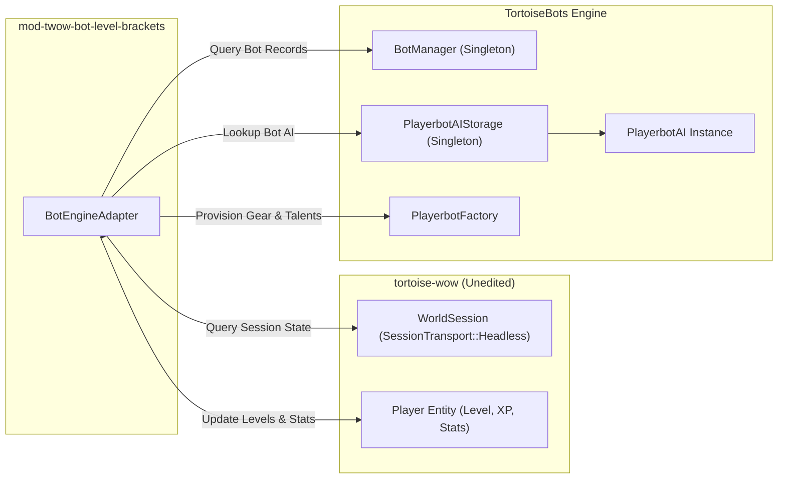
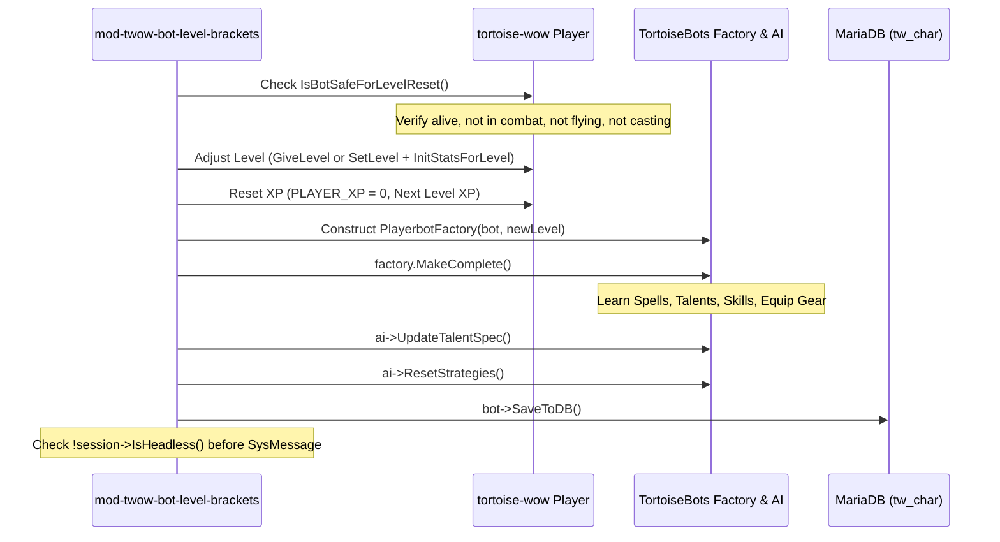

# Technical Specification: TortoiseBots Adapter (`mod-twow-bot-level-brackets`)

> **Target Bot Engine**: `TortoiseBots` (Main Branch / Native Modular for Tortoise WoW 1.18.1)  
> **Host Server**: `tortoise-wow` (Turtle WoW Custom vMaNGOS)  
> **Status**: Production Reference Specification

---

## 1. Engine Architecture & Decoupling Philosophy

`TortoiseBots` is designed under the **Zero Core Coupling Invariant**:
* Core code never knows a `Player` is a bot.
* There is no `WorldSession::GetBot()`, no `Player::m_bot`, and no `sPlayerBotMgr`.
* Bot sessions run as generic `SessionTransport::Headless` instances owned by `HeadlessSessionMgr` in the core engine.
* All bot AI state, lifecycle tracking, strategies, and inventory generation live strictly inside the `TortoiseBots` module.

The `mod-twow-bot-level-brackets` module integrates with `TortoiseBots` via public module APIs without touching core headers.



---

## 2. Core Integration Seams & Interfaces

### 2.1 Bot Lifecycle & Identity (`BotManager`)
Located in `TortoiseBots/runtime/BotManager.h`:

* **`BotManager::Instance().IsBot(ObjectGuid guid)`**:
  Queries whether a character GUID is tracked by the bot runtime.
* **`BotManager::Instance().IsRandomBot(ObjectGuid guid)`**:
  Returns `true` strictly if the bot belongs to the autonomous wandering pool (`record.random == true`), distinguishing random bots from hired player companions or offline alts.
* **`BotManager::Instance().FindBot(ObjectGuid guid)`**:
  Retrieves the underlying `BotRecord` struct containing:
  ```cpp
  struct BotRecord {
      uint32_t accountId;
      ObjectGuid characterGuid;
      ObjectGuid masterGuid;       // Active human or bot master
      uint32_t ownerAccountId;    // 0 for unowned random bots
      bool random;                // True for autonomous pool bots
      BotLifecycle lifecycle;
  };
  ```

### 2.2 AI Object Registry (`PlayerbotAIStorage`)
Located in `TortoiseBots/runtime/PlayerbotAIStorage.h`:

* **`PlayerbotAIStorage::Instance().GetAI(Player* player)`**:
  Retrieves the active `PlayerbotAI*` pointer mapped to the player.
* **Master Verification**:
  ```cpp
  PlayerbotAI* ai = PlayerbotAIStorage::Instance().GetAI(bot);
  if (ai && ai->HasRealPlayerMaster())
      return true; // Protected from bracket redistribution
  ```

### 2.3 Comprehensive Provisioning Pipeline (`PlayerbotFactory::MakeComplete`)
Located in `TortoiseBots/ai/playerbot/PlayerbotFactory.h`:

In legacy PlayerBots, bots were re-leveled via `PlayerbotFactory::Randomize(bool, bool)`. In `TortoiseBots`, `MakeComplete()` provides an idempotent, level-bounded re-provisioning pass:

```cpp
void PlayerbotFactory::MakeComplete()
{
    if (!bot || !ai)
        return;

    // 1. Roll or retain premade talent build
    if (!sRandomBotFacade.GetValue(bot, "specNo"))
        SelectPremadeSpecNo();
    ai->DoSpecificAction("auto talents");

    // 2. Auto-learn level-appropriate class spells
    ai->DoSpecificAction("auto learn spell");

    // 3. Train skills (including armor threshold upgrades at level 40)
    InitSkills();

    // 4. Generate level-appropriate gear bounded by pool cap
    UsePoolGearCap();
    InitEquipment(true, false);

    // 5. Populate starter consumables and class kit
    InitThrown();
    InitBags();
    InitInventorySkill();
    InitMounts();
    SeedFreshMoney();
    InitAmmo();
    InitReagents();
    InitPotions();
    InitFood();
    AddConsumables();
    InitBandages();

    // 6. Prune duplicate equip rows and apply enchants
    PruneDuplicateEquipRows();
    EnchantEquipment();

    // 7. Commit character state to database
    bot->SaveToDB();
}
```

---

## 3. The Re-Leveling Execution Workflow

When `mod-twow-bot-level-brackets` determines that an overpopulated bracket bot should transition to an underpopulated bracket, it executes the following sequence:



---

## 4. Headless Session Isolation & Packet Safeguards

In `tortoise-wow`, bots are instantiated as headless sessions with no network socket (`SessionTransport::Headless`).

* **SysMessage Packet Suppression**:
  Dispatching `ChatHandler(bot->GetSession()).SendSysMessage(...)` to a headless session serializes an unused packet and wastes server CPU.
  `BotEngineAdapter` explicitly checks:
  ```cpp
  if (bot->GetSession() && !bot->GetSession()->IsHeadless())
  {
      ChatHandler(bot->GetSession()).SendSysMessage(...);
  }
  ```
* **Human Reclaim Invariant**:
  If a real player logs into a character currently occupied by a bot, the core's `ReclaimHeadlessSession` immediately unbinds the bot. `BotLevelBracketsPlayerScript::OnLogout` instantly removes the bot from pending reset queues, ensuring zero collision with human logins.
